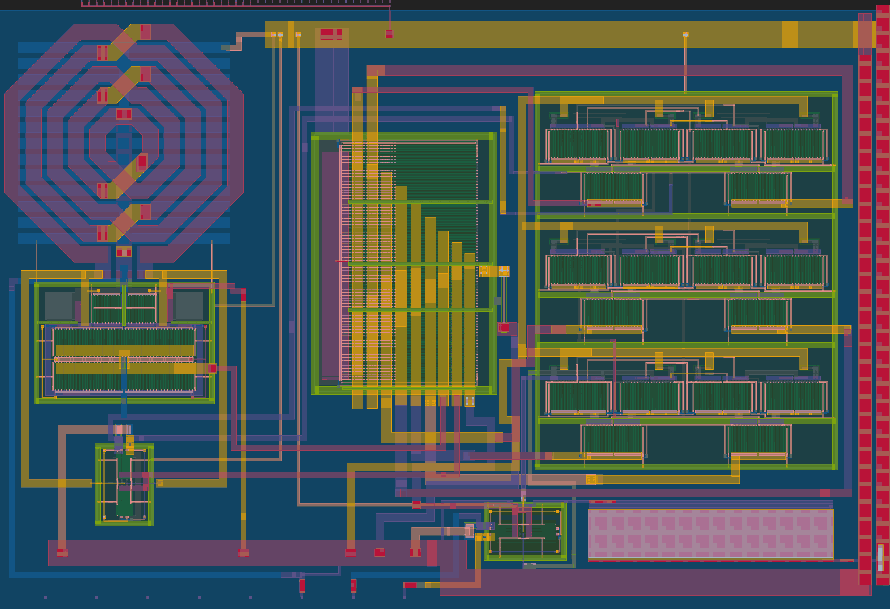

 

# 5 GHz VCO with ÷8 divider (Tiny Tapeout SKY26d)

An FM transmitter on a Tiny Tapeout 2x2 analog tile (SKY130).
An NMOS LC VCO running at around 5 GHz feeds a CML divide-by-8, so the output is in the 600–700 MHz range.
Feeding audio (e.g. a guitar) into `vcont` makes FM that you can receive with an SDR.

## Pins

| Pin | Function |
|---|---|
| ua[0] | RF output (+), around 600–700 MHz |
| ua[1] | RF output (−) |
| ua[2] | vcont, VCO tuning input (around 0.4 V) |

## Notes

- The output frequency depends on vcont, supply voltage, process and temperature.
- The VCO is sensitive to supply noise, so a clean LDO is recommended.

## Documentation

How it works and how to test it: [docs/info.md](docs/info.md)

## About Tiny Tapeout

[Tiny Tapeout](https://tinytapeout.com) is an educational project that makes it easier and cheaper to get designs manufactured on a real chip.
