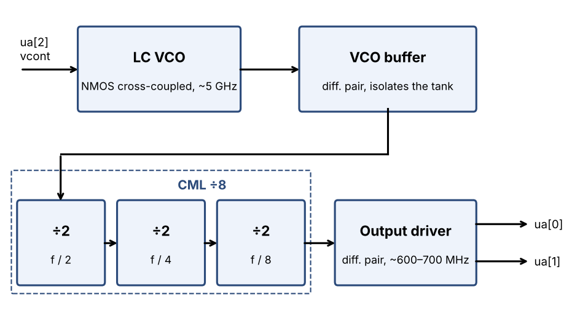
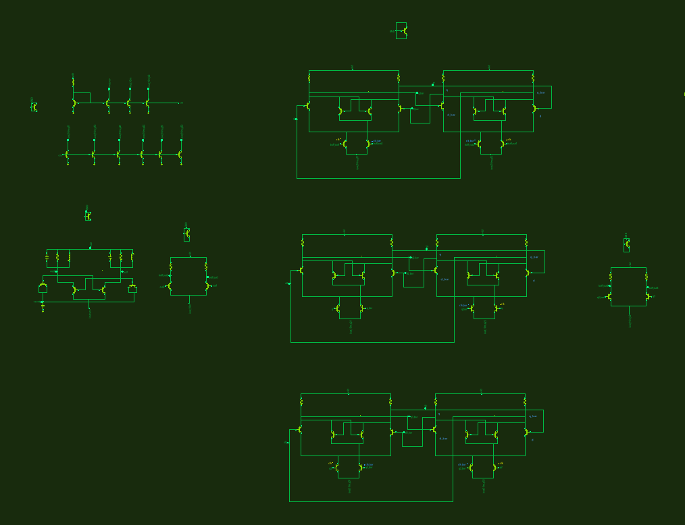
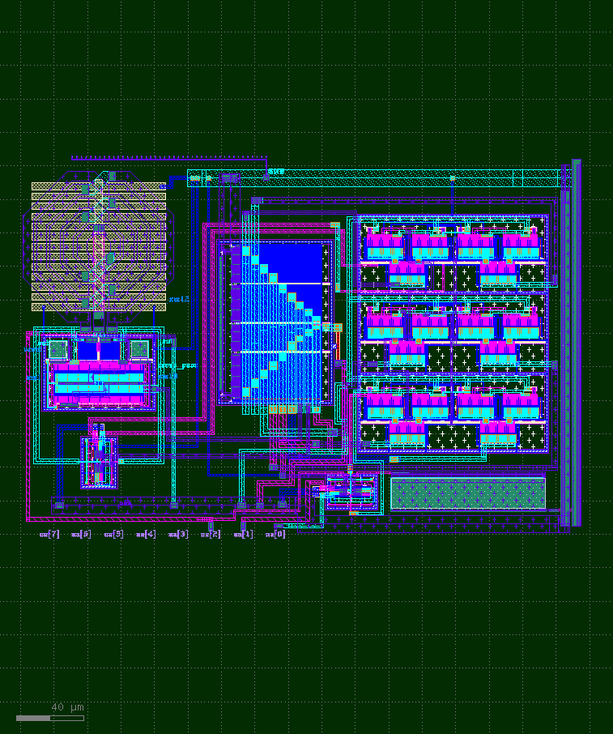

## How it works

This is a small FM transmitter. An NMOS cross-coupled LC VCO runs at around 5 GHz. A buffer stage feeds a CML divide-by-8 (three ÷2 stages), and an output driver brings the divided signal, expected to be somewhere in the 600–700 MHz range, off chip.

The VCO frequency is tuned by the voltage on `ua[2]` (vcont) through on-chip varactors. Putting an audio signal on top of a DC bias on vcont therefore gives frequency modulation (FM), which can be received with an SDR.

> **Note:** This design has not been measured yet. All numbers below come from simulation and should be taken as rough expectations. The real chip may differ because of process variation, temperature, supply voltage and the TT analog pin path.

### Pins

| Pin | Function |
|---|---|
| ua[0] | RF output (+) |
| ua[1] | RF output (−), complementary to ua[0] |
| ua[2] | vcont – VCO tuning input. There is an on-chip MIM capacitor from this pin to ground for filtering. |

### Expected behaviour (from simulation)

- VCO: around 5 GHz; output after ÷8: roughly 600–700 MHz
- The output frequency rises with vcont. Simulation suggests a usable range of roughly 0.1–0.8 V, with around 0.4 V as a reasonable starting point.
- Tuning sensitivity at the output is on the order of a few MHz/V, so a small audio signal (tens to hundreds of mV) should give an FM deviation in the tens to hundreds of kHz.
- The frequency is also sensitive to the supply voltage, so supply noise will appear as unwanted FM.

## How to test

1. **Power:** supply VDPWR (1.8 V) from a clean, low-noise source such as an LDO. Watch the supply current when you first power up.
2. **vcont:** keep `ua[2]` between 0 V and 1.8 V. Bias it at about 0.4 V through a resistor (for example a few hundred Ω), then add the audio signal on top (for example a guitar through a preamp, AC-coupled).
3. **Output:** the outputs are resistively loaded to VDPWR inside the chip, so connect `ua[0]` to the receiver **through a DC-blocking capacitor**. `ua[1]` can be used the same way, or both can be combined through a balun for a differential connection. The TT analog pin path adds series resistance, so expect a modest output level.
4. **Receive:** connect the output to an SDR, search around 600–700 MHz for the carrier, then listen in WFM or NFM mode.
5. **Tuning:** sweep vcont slowly and note how the carrier moves. This gives the actual tuning curve of your chip.

## External hardware

- Low-noise LDO (or other clean 1.8 V supply)
- Bias network / preamp for vcont (e.g. guitar preamp)
- DC-blocking capacitor (and optionally a balun) on the RF output
- SDR receiver that covers 600–700 MHz (e.g. RTL-SDR, HackRF)
